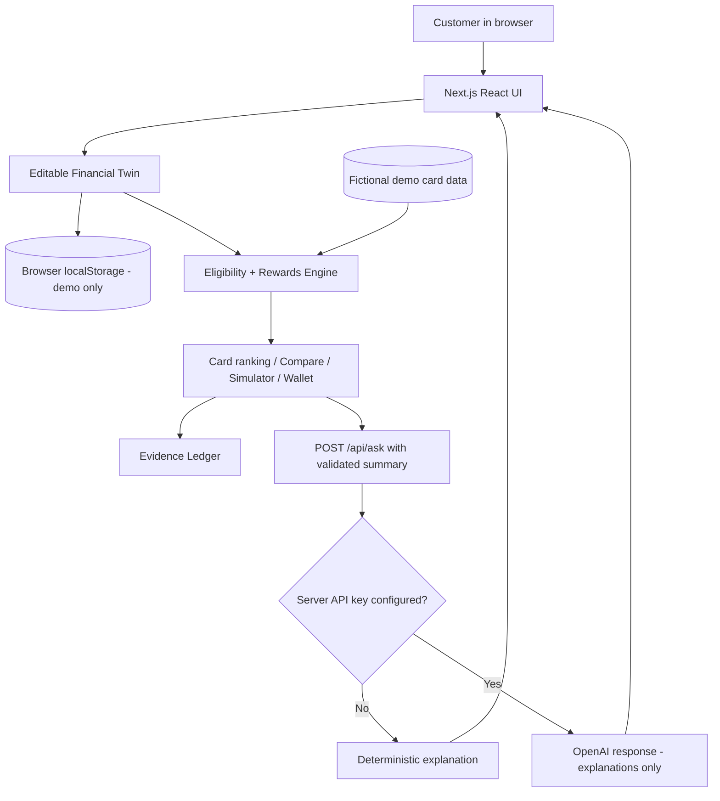

# VALORA architecture

The authoritative quantitative path is `lib/engine.ts`. The language model cannot change numeric results; it receives only an already-calculated, Zod-validated context summary. Demo mode is 100% fictional and uses browser persistence, not a production financial data store. For a real launch, add a verified issuer ingestion process, auditable term versions, secure authentication and PostgreSQL persistence, monitoring, card-specific redemption schedules, richer interest models and compliance review.
